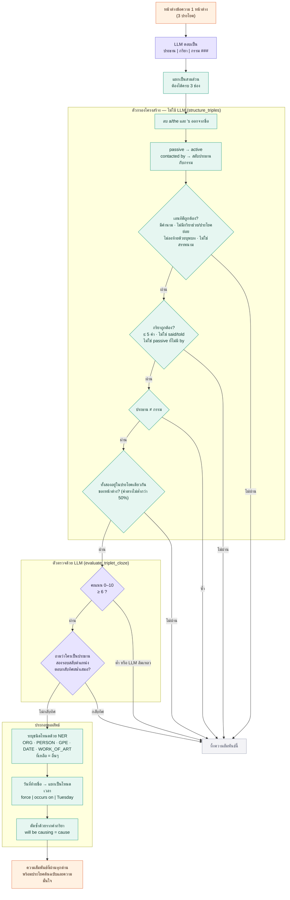
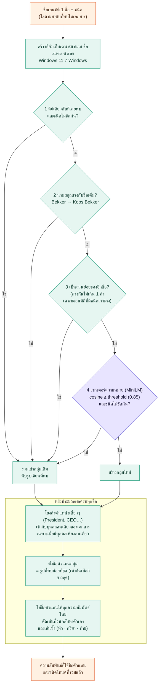
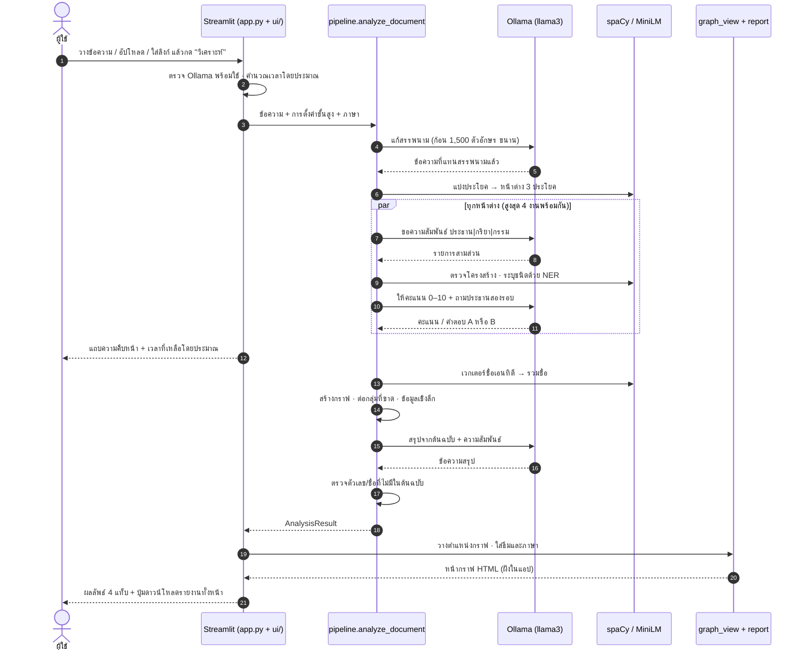
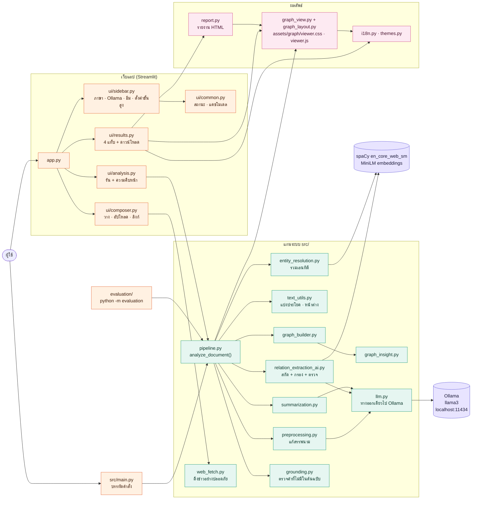

# สถาปัตยกรรมและการทำงานของระบบ

ระบบรับเอกสารภาษาอังกฤษ ใช้ LLM บนเครื่อง (Ollama + llama3) สกัดความสัมพันธ์แบบ "ประธาน – กริยา – กรรม"
แล้วสร้างเป็นกราฟความรู้ พร้อมข้อมูลเชิงลึก สรุป และรายงานดาวน์โหลด ข้อมูลไม่ออกนอกเครื่อง ยกเว้นตอนดึงข่าวจากลิงก์

แผนภาพในเอกสารนี้เขียนด้วย Mermaid (แสดงผลได้ใน GitHub และตัวดู Markdown ของ VS Code) และมีไฟล์ภาพ SVG/PNG ให้ใช้ในสไลด์หรือรายงาน

| แผนภาพ | ไฟล์ภาพ | ต้นฉบับ |
| --- | --- | --- |
| 1. ภาพรวมการทำงานตั้งแต่รับเอกสารถึงแสดงผล | [SVG](diagrams/01-pipeline.svg) · [PNG](diagrams/01-pipeline.png) | [mmd](diagrams/01-pipeline.mmd) |
| 2. ด่านสกัดและกรองความสัมพันธ์ต่อหน้าต่าง | [SVG](diagrams/02-extraction.svg) · [PNG](diagrams/02-extraction.png) | [mmd](diagrams/02-extraction.mmd) |
| 3. ขั้นตอนตัดสินใจรวมเอนทิตี | [SVG](diagrams/03-entity-resolution.svg) · [PNG](diagrams/03-entity-resolution.png) | [mmd](diagrams/03-entity-resolution.mmd) |
| 4. โครงสร้างโมดูลและการเรียกใช้กัน | [SVG](diagrams/04-modules.svg) · [PNG](diagrams/04-modules.png) | [mmd](diagrams/04-modules.mmd) |
| 5. ลำดับเหตุการณ์เมื่อผู้ใช้กด "วิเคราะห์" | [SVG](diagrams/05-run-sequence.svg) · [PNG](diagrams/05-run-sequence.png) | [mmd](diagrams/05-run-sequence.mmd) |

สี: ม่วง = ขั้นที่เรียก LLM · เขียว = กฎ/โค้ดปกติ (ไม่ใช้ LLM) · ส้ม = จุดเข้า/ออกของข้อมูล

## 1. ภาพรวม

```mermaid
flowchart TD
    IN["<b>Input document</b><br/>เอกสารนำเข้า: paste text · .txt upload · news URL"]
    URL["<b>URL fetch</b> (SSRF guard)<br/>public IP only · ≤ 2 MB · ≤ 3 redirects<br/>HTML → plain text"]
    CUT["<b>Truncate</b> at sentence boundary<br/>ถ้าเกิน max_chars (default 6,000)"]

    subgraph PRE["① Preprocessing"]
        COREF["<b>Coreference resolution</b> (LLM)<br/>แทน he/she/they ด้วยชื่อจริง<br/>chunk 1,500 chars · parallel"]
        GUARD{"<b>Sanity check</b><br/>prompt echo หรือ<br/>length ratio นอก 0.7–1.4×?"}
        KEEP["<b>Fallback</b><br/>ใช้ข้อความเดิมของ chunk นั้น"]
        SPLIT["<b>Sentence segmentation</b><br/>(spaCy)"]
        WIN["<b>Sliding window</b><br/>3 sentences · overlap 1"]
    end

    subgraph EXT["② Relation extraction (see diagram 02)"]
        PAR["<b>Triple extraction</b> (LLM) per window<br/>subject | predicate | object<br/>parallel · max 4 workers (LLM_WORKERS)"]
        CONF{"<b>Confidence filter</b><br/>score ≥ min_confidence (0.7)?"}
    end

    RES["③ <b>Entity resolution</b><br/>merge mentions ที่หมายถึงสิ่งเดียวกัน<br/>rules + embedding similarity (see diagram 03)"]

    subgraph GR["④ Graph construction & insights"]
        BUILD["<b>Build MultiDiGraph</b> (networkx)<br/>hub / main topic = node ที่มี degree สูงสุด"]
        VIRT["<b>Connect components</b><br/>ต่อกลุ่มที่ขาดกันเข้า hub<br/>ด้วย virtual edge (เส้นประ)"]
        INS["<b>Graph analytics</b> (ไม่นับ virtual edge)<br/>density · communities · centrality<br/>bridge nodes · frequent predicates"]
    end

    subgraph SUM["⑤ Summarization"]
        LLMS["<b>Graph-augmented summary</b> (LLM)<br/>source text ≤ 8,000 chars<br/>+ relations จัดกลุ่มตาม sentence"]
        GROUND["<b>Grounding check</b><br/>numbers / proper nouns ที่ไม่มีใน source<br/>→ highlight + warning"]
    end

    OUT["<b>AnalysisResult</b><br/>relations · insights · graph · summary · text · stats"]

    subgraph SHOW["⑥ Presentation & export"]
        TABS["<b>Streamlit app</b> 4 tabs<br/>Graph · Relations · Insights · Summary"]
        REP["<b>HTML report</b><br/>self-contained single file"]
        EXP["<b>Export</b><br/>CSV · JSON · Markdown · graph HTML"]
    end

    IN --> CUT
    IN -.->|"if URL"| URL --> CUT
    CUT --> COREF --> GUARD
    GUARD -->|"yes"| KEEP --> SPLIT
    GUARD -->|"no"| SPLIT
    SPLIT --> WIN --> PAR --> CONF
    CONF -->|"pass"| RES
    CONF -->|"fail"| DROP["<b>Drop</b><br/>ทิ้ง"]
    RES --> BUILD --> VIRT --> INS --> OUT
    RES --> LLMS --> GROUND --> OUT
    OUT --> TABS
    OUT --> REP
    OUT --> EXP

    classDef llm fill:#e8e4ff,stroke:#6b63d9,color:#1d1b3a;
    classDef rule fill:#e6f6f1,stroke:#1f9a7a,color:#0f3a2e;
    classDef io fill:#fff1e2,stroke:#e4693a,color:#40200e;
    classDef stop fill:#f3f3f6,stroke:#9aa0b4,color:#4a4f63;
    class COREF,PAR,LLMS llm;
    class SPLIT,WIN,CUT,URL,GUARD,KEEP,CONF,BUILD,VIRT,INS,GROUND,RES rule;
    class IN,OUT,TABS,REP,EXP io;
    class DROP stop;
```



## 2. แต่ละขั้นตอนทำอะไร

### นำเข้า ([ui/composer.py](../ui/composer.py), [src/web_fetch.py](../src/web_fetch.py))
- รับข้อความที่วาง ไฟล์ `.txt` หรือลิงก์ข่าว ลิงก์ต้องเป็น http/https และชี้ไป IP สาธารณะเท่านั้น จำกัด 2 MB
  และตามรีไดเรกต์ไม่เกิน 3 ครั้ง เพื่อกันการยิงเข้าเครือข่ายภายใน
- ถ้าเอกสารยาวเกินค่าที่ตั้ง (ค่าเริ่มต้น 6,000 ตัวอักษร) จะตัดที่ท้ายประโยค และแจ้งผู้ใช้

### ① เตรียมข้อความ ([src/preprocessing.py](../src/preprocessing.py), [src/text_utils.py](../src/text_utils.py))
- **แก้สรรพนาม:** แบ่งเป็นก้อน 1,500 ตัวอักษร ให้ LLM แทน he/she/they ด้วยชื่อจริง โดยตอบในแท็ก `<rewritten>`
  ปฏิเสธผลที่ลอก prompt กลับมา หรือยาวสั้นต่างจากต้นฉบับเกิน 0.7–1.4 เท่า แล้วใช้ข้อความเดิมของก้อนนั้น
- **แบ่งประโยค** ด้วย spaCy แล้วรวมเป็น **หน้าต่างละ 3 ประโยค ซ้อนกัน 1 ประโยค** เพื่อไม่ให้ความสัมพันธ์ขาดตรงรอยต่อ

### ② สกัดความสัมพันธ์ ([src/relation_extraction_ai.py](../src/relation_extraction_ai.py))
ทำต่อหน้าต่าง เรียก LLM ขนานสูงสุด 4 งาน (`LLM_WORKERS`) ผลเรียงตามลำดับเอกสารเสมอ



- **ตัวกรองโครงสร้าง** (`structure_triples`) ไม่ใช้ LLM จึงเร็วและรันซ้ำได้ผลเดิม ตัดเอนทิตีที่ไม่ใช่คำนาม กริยาบอกเล่า
  และความสัมพันธ์ที่เอนทิตีไม่อยู่ในประโยคเดียวกัน (ป้องกันการแต่งเรื่องข้ามประโยค)
- **ตัวตรวจด้วย LLM** (`evaluate_triplet_cloze`) ให้คะแนน 0–10 ว่าตรงกับข้อความ และถามซ้ำสองรอบสลับตำแหน่งว่า "ใครเป็นประธาน"
  เพื่อจับความสัมพันธ์ที่กลับทิศ ตัดเฉพาะกรณีที่ตอบกลับทิศอย่างสม่ำเสมอ (ถ้าตอบไม่นิ่งถือว่าไม่แน่ใจ ไม่ตัด)
- ถ้าเรียก LLM ล้มเหลวจะ **ปฏิเสธความสัมพันธ์นั้น** (fail closed) ไม่ปล่อยผ่าน
- หลังจากนั้นกรองตาม "ความมั่นใจขั้นต่ำ" (ค่าเริ่มต้น 0.7)

### ③ รวมเอนทิตี ([src/entity_resolution.py](../src/entity_resolution.py))
ใช้หนึ่งตัวต่อหนึ่งเอกสาร ไม่ข้ามเอกสาร (กันเอนทิตีจากเอกสารก่อนหน้ารั่วเข้ามา) ไล่ชื่อตามลำดับที่พบในเอกสาร



### ④ กราฟและข้อมูลเชิงลึก ([src/graph_builder.py](../src/graph_builder.py), [src/graph_insight.py](../src/graph_insight.py))
- สร้าง MultiDiGraph (คู่โหนดเดียวกันมีได้หลายความสัมพันธ์และหลายทิศ) โหนดที่มีเส้นมากที่สุดเป็น **หัวข้อหลัก**
  (เท่ากันเลือกตามตัวอักษร ผลจึงไม่สุ่ม)
- กลุ่มที่ขาดจากกันถูกต่อเข้ากับหัวข้อหลักด้วย **เส้นประสีแดง** เพื่อให้กราฟอ่านเป็นภาพเดียว เส้นเหล่านี้ระบบเติมเอง
  ไม่ได้มาจากข้อความ จึงไม่ถูกนับในข้อมูลเชิงลึก
- ข้อมูลเชิงลึก: จำนวนโหนด/เส้น ความหนาแน่น จำนวนกลุ่มที่ไม่เชื่อมกัน กลุ่มเนื้อหา (community, greedy modularity)
  เอนทิตีศูนย์กลาง (degree) ตัวเชื่อม (betweenness) และความสัมพันธ์ที่พบบ่อย

### ⑤ สรุปและตรวจข้อเท็จจริง ([src/summarization.py](../src/summarization.py), [src/grounding.py](../src/grounding.py))
- LLM สรุปจากข้อความต้นฉบับ (ไม่เกิน 8,000 ตัวอักษร) ร่วมกับความสัมพันธ์ที่จัดกลุ่มตามประโยค (ไม่เกิน 4,000 ตัวอักษร)
- ตัวตรวจ (ไม่ใช้ LLM) หาตัวเลขและชื่อเฉพาะในสรุปที่ไม่พบในต้นฉบับ แล้วไฮไลต์พร้อมเตือน ข้ามหัวข้อ เลขข้อ ป้ายอย่าง "Note:"
  พหูพจน์ ตัวสะกดอเมริกัน/อังกฤษ และตัวเลขที่ต้นฉบับเขียนเป็นคำ ตรวจที่ตัวคำ **ไม่ได้ตรวจความหมาย**

### ⑥ แสดงผล
- **กราฟ** ([src/graph_view.py](../src/graph_view.py), [src/graph_layout.py](../src/graph_layout.py), [assets/graph/](../assets/graph/)):
  PyVis ฝัง HTML ทั้งหน้า วางตำแหน่งล่วงหน้าด้วย Kamada-Kawai ต่อกลุ่ม จัดกลุ่มเรียงเป็นวงรอบหัวข้อหลัก ไม่ใช้ฟิสิกส์
  (ผลเหมือนเดิมทุกครั้ง) มีตัวเลื่อน "ความสำคัญ" (เก็บ N เส้นสำคัญสุด จัดอันดับจากความเชื่อมโยงของปลายทั้งสองข้างและจำนวนครั้งที่พบ
  ไม่ต้องวิเคราะห์ใหม่) ปุ่มซูม จัดเรียงใหม่ โหมดมืด และแผงรายละเอียดเมื่อคลิกโหนด ชื่อในแผงถูก escape กันโค้ดแทรก
- **รายงานทั้งหน้า** ([src/report.py](../src/report.py)): HTML ไฟล์เดียวมีสรุป กราฟโต้ตอบ (ฝังใน iframe แบบ sandbox)
  ข้อมูลเชิงลึก และตารางความสัมพันธ์ที่ค้นหาได้ ตามภาษาและธีมที่เลือก
- **แอปเว็บ** ([app.py](../app.py) + [ui/](../ui/)): Streamlit แยกเป็นแถบข้าง ช่องใส่ข้อความ การรันพร้อมความคืบหน้า และผลลัพธ์ 4 แท็บ
  รองรับไทย/อังกฤษ ([src/i18n.py](../src/i18n.py)) และ 6 ธีมสี ([src/themes.py](../src/themes.py)) ส่งออกได้ทั้ง HTML CSV JSON และสรุป .md
- **บรรทัดคำสั่ง** ([src/main.py](../src/main.py)): `python -m src.main ไฟล์.txt` เขียนกราฟลง `output/knowledge_graph.html`

## 3. ลำดับเหตุการณ์เมื่อกด "วิเคราะห์"



## 4. โครงสร้างโมดูล



| ส่วน | ไฟล์ | หน้าที่ |
| --- | --- | --- |
| จุดเข้า | [app.py](../app.py) | ตั้งค่าหน้า ใส่สไตล์ แล้วเรียกส่วนต่างๆ ของ `ui/` ตามลำดับ |
| UI | [ui/](../ui/) | `sidebar`, `composer`, `analysis`, `results`, `common` แยกตามส่วนของหน้าจอ |
| แกนระบบ | [src/pipeline.py](../src/pipeline.py) | `analyze_document()` ประสานทุกขั้น ส่งความคืบหน้าและวัดเวลาแต่ละขั้น |
| LLM | [src/llm.py](../src/llm.py) | ทางออกเดียวไป Ollama (กำหนด model, context, timeout, โหมด JSON) |
| ตั้งค่า | [src/config.py](../src/config.py) | ค่าคงที่และตัวแปรสภาพแวดล้อม |
| ออนโทโลยี | [src/ontology.py](../src/ontology.py) | แปลงป้าย NER เป็นชนิดโหนด: ORG→องค์กร PERSON→บุคคล GPE→สถานที่ DATE→เวลา WORK_OF_ART→ผลงาน |
| ภาษาและธีม | [src/i18n.py](../src/i18n.py), [src/themes.py](../src/themes.py) | ข้อความ UI สองภาษา (มีเทสต์ว่าคีย์ครบตรงกัน) และสีของแต่ละธีม |
| วัดผล | [evaluation/](../evaluation/) | `python -m evaluation <ชื่อ>` เรียกโค้ดจริงของระบบ ผลล่าสุดอยู่ใน [evaluation/REPORT.md](../evaluation/REPORT.md) |
| เทสต์ | [tests/](../tests/) | pytest ไม่ต้องใช้ Ollama |
| ไม่ได้ใช้ | [src/entity_extraction.py](../src/entity_extraction.py) | ไฟล์ตกค้าง ไม่มีส่วนใดเรียกใช้ (ลบได้) |

## 5. ข้อมูลที่ไหลผ่านระบบ

`analyze_document()` คืน `AnalysisResult` ที่ทุกส่วนของ UI ใช้ร่วมกัน

| ฟิลด์ | เนื้อหา |
| --- | --- |
| `relations` | รายการความสัมพันธ์หลังรวมเอนทิตี แต่ละรายการมี head, relation, tail, ชนิดของหัว/ท้าย, ความมั่นใจ, ประโยคต้นฉบับ |
| `insights` | ผลวิเคราะห์กราฟ (จำนวน ความหนาแน่น กลุ่ม ศูนย์กลาง ตัวเชื่อม ฯลฯ) |
| `graph` / `html` | กราฟ networkx และ HTML กราฟโต้ตอบ (วาดใหม่เมื่อเปลี่ยนธีม/ภาษาโดยไม่ต้องวิเคราะห์ซ้ำ) |
| `summary` | ข้อความสรุปจาก LLM |
| `text` | ข้อความที่วิเคราะห์จริง (หลังตัด) ใช้ตรวจสรุปกับต้นฉบับ |
| `stats` | เวลารวมและเวลาแต่ละขั้น, จำนวนประโยค/หน้าต่าง/ความสัมพันธ์, ถูกตัดหรือไม่, คำในสรุปที่ไม่อยู่ในต้นฉบับ |

## 6. การตั้งค่า

| ค่า | ค่าเริ่มต้น | หมายเหตุ |
| --- | --- | --- |
| `OLLAMA_URL` | `http://localhost:11434/api/generate` | ตั้งผ่านตัวแปรสภาพแวดล้อมได้ |
| `LLM_MODEL` | `llama3` | ตั้งผ่านตัวแปรสภาพแวดล้อมได้ |
| `LLM_TIMEOUT` | 120 วินาที/คำขอ | ตั้งผ่านตัวแปรสภาพแวดล้อมได้ |
| `LLM_NUM_CTX` | 8192 | ตั้งผ่านตัวแปรสภาพแวดล้อมได้ |
| `LLM_WORKERS` | 4 | จำนวนคำขอ LLM ขนาน ตั้งผ่านตัวแปรสภาพแวดล้อมได้ |
| `RESOLVER_THRESHOLD` | 0.85 | เกณฑ์รวมเอนทิตี ปรับได้ในแอป (0.70–0.99) |
| `MIN_CONFIDENCE` | 0.7 | ความมั่นใจขั้นต่ำ ปรับได้ในแอป (0.6–1.0) |
| `WINDOW_SIZE` / `WINDOW_OVERLAP` | 3 / 1 | ขนาดหน้าต่างประโยค ปรับได้ในแอป |
| `COREF_CHUNK_CHARS` | 1,500 | ขนาดก้อนตอนแก้สรรพนาม |
| `SUMMARY_TEXT_CHARS` / `SUMMARY_GRAPH_CHARS` | 8,000 / 4,000 | งบตัวอักษรที่ส่งให้ LLM ตอนสรุป |

## 7. จุดอ่อนที่รู้แล้ว

ตัวเลขและข้อสังเกตเต็มอยู่ใน [evaluation/REPORT.md](../evaluation/REPORT.md)

- รับเฉพาะภาษาอังกฤษ
- ช้า: ราว 2 นาทีต่อบทความ 400 คำ (59% อยู่ที่ขั้นสกัดความสัมพันธ์)
- ตัวกรองทิ้งความสัมพันธ์ที่ถูกต้องราว 43% เพื่อแลกความแม่นยำ
- การรวมเอนทิตีที่ค่าเริ่มต้นรวมน้อยไป (จับได้ ~28% ของคู่ที่ควรรวมในชุดทดสอบเล็ก)
- สรุปจาก LLM อาจเติมข้อมูลเอง ตัวตรวจจับได้เฉพาะตัวเลขและชื่อ
- โมดูลแก้สรรพนามกับสรุปถูกสั่งแทรกสำเร็จได้บางส่วน (5 จาก 72 ครั้งในการทดสอบ)

## 8. สร้างแผนภาพใหม่

แก้ไฟล์ `.mmd` ใน [diagrams/](diagrams/) แล้วรัน

```
pip install playwright        # และต้องมี Chrome
python docs/render_diagrams.py
```

สคริปต์ [render_diagrams.py](render_diagrams.py) เรนเดอร์ SVG และ PNG ทุกแผนภาพ (ต้องต่ออินเทอร์เน็ตเพื่อโหลด Mermaid และฟอนต์)
ถ้าแก้แผนภาพ อย่าลืมแก้บล็อกแผนภาพ Mermaid ที่ตรงกันในไฟล์นี้ด้วย
